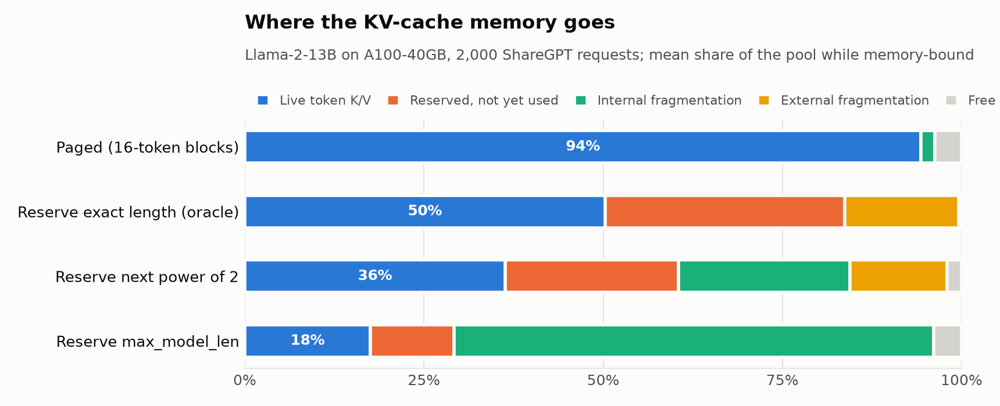
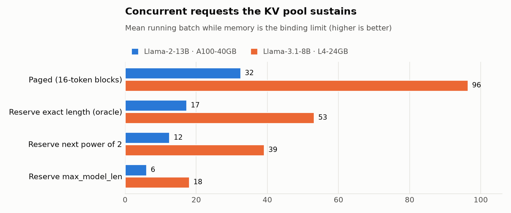
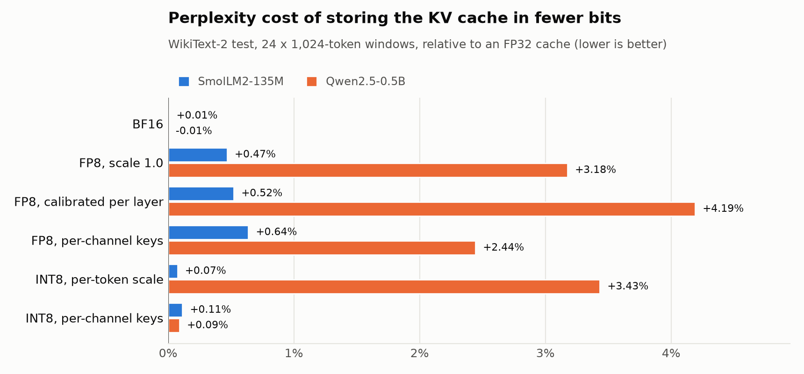

# pagedkv: a paged KV-cache memory manager for LLM inference

A library for the memory side of LLM serving: how big the KV cache really is for a
given model, how to hand it out in fixed-size pages without fragmentation, how to
share it between requests, and how to store it in fewer bits without losing
accuracy. Pure-Python allocator, PyTorch reference attention, a Triton
paged-attention decode kernel, and a Llama/Qwen model that runs on all of it.

**Measured results** (details and methodology below):

* **Allocator.** On ShareGPT request lengths, Llama-2-13B on an A100-40GB budget, paged
  allocation keeps **94% of the KV pool holding live tokens**, against 18% when each
  request reserves `max_model_len` and 50% even with an oracle that knows every output
  length. That is a **5.4x larger running batch** than reserve-max (1.9x over the oracle).
  This is an allocator-level simulation, not a timed GPU run.
* **KV quantization.** Qwen2.5's keys carry outlier channels (the largest peaks up to 44x
  above the median channel). Per-token INT8 KV costs **+3.43% perplexity**; calibrated
  per-channel key scales bring it to **+0.09%**, with the cache 1.94x smaller than BF16 (WikiText-2).
* **Correctness.** Batched greedy decoding on the paged cache is **token-for-token
  identical to `transformers.generate`** on SmolLM2-135M and Qwen2.5-0.5B, and on tiny
  random Llama / Llama-3-RoPE / Qwen2 / Qwen3 / Mistral-SWA models in CI.
* **Estimator.** The capacity estimator models GQA, MLA, sliding-window and hybrid
  (Mamba/conv) layers and matches the cache transformers allocates **byte for byte
  across 21 architectures**, from SmolLM2-135M to Kimi-K2 (1T). The textbook formula
  this repo used to ship was 8x too high for Llama-70B.

<picture>
  <source media="(prefers-color-scheme: dark)" srcset="docs/img/memory-breakdown-dark.png">
  
</picture>

## What is in here

| Module | What it does |
|---|---|
| [`spec.py`](src/pagedkv/spec.py), [`estimate.py`](src/pagedkv/estimate.py) | Per-layer KV layout from any HF `config.json` (GQA, MLA latent, sliding windows, `layer_types`, Jamba/Granite-H/LFM2 hybrids, quantized formats with scale overhead, tensor-parallel sharding) and GPU capacity plans. |
| [`block_pool.py`](src/pagedkv/block_pool.py), [`manager.py`](src/pagedkv/manager.py) | The allocator: ref-counted blocks, LRU free queue, SHA-256 hash-chained prefix cache with per-tenant salts, copy-on-write `fork`, swap to a host pool that skips blocks still resident in the prefix cache, admission watermark. Engine-agnostic: it returns copy plans instead of moving memory. |
| [`cache.py`](src/pagedkv/cache.py) | The physical cache tensor `[layers, blocks, 2, block_size, kv_heads, head_dim]` with bf16/fp16/fp32, FP8 (static scales) and INT8 (per-token or calibrated per-channel key scales) storage, block copy and host transfer. |
| [`ops/reference.py`](src/pagedkv/ops/reference.py) | Paged attention in plain PyTorch for any mix of prefill, chunked prefill, prefix hits and decode. The oracle for everything else. |
| [`ops/triton_paged.py`](src/pagedkv/ops/triton_paged.py) | Triton decode kernel: one program per (sequence, KV head) handling the whole GQA query group with tensor-core `tl.dot`, online softmax over pages, split-KV (flash-decoding) with a log-sum-exp merge for long contexts, in-register FP8 dequantization. |
| [`models/llama.py`](src/pagedkv/models/llama.py), [`generate.py`](src/pagedkv/generate.py) | Llama 2/3, Mistral, Qwen2/2.5, Qwen3 and SmolLM2 on the paged cache (HF weights load as-is), plus a batched generation/scoring harness. |
| [`sim/`](src/pagedkv/sim) | Iteration-level scheduler simulator comparing paged allocation with reserve-up-front allocation (max / power-of-two / oracle, first-fit contiguous). |

## Results

### Allocator: paged vs. reserve-up-front

<picture>
  <source media="(prefers-color-scheme: dark)" srcset="docs/img/batch-size-dark.png">
  
</picture>

<!-- BEGIN:allocator -->
2,000 requests sampled from ShareGPT (mean prompt 110 tokens, mean output 329; Llama 2 tokenizer; vLLM's benchmark filters), all queued at t=0, `max_num_seqs=256`. The pool is the KV budget left on the GPU after bf16 weights, 90% memory utilization and 2 GiB of overhead (`pagedkv capacity`). "Batch" is the mean number of running sequences on steps where memory was the binding limit; "steps" is forward passes to drain the queue.

**Llama-2-13B (MHA) on A100-40GB: the vLLM paper's memory regime** (12,787-token pool)

| Allocator | Batch | Steps to drain | Live K/V | Reserved | Internal frag. | External frag. | Preemptions |
|---|---:|---:|---:|---:|---:|---:|---:|
| Paged, 16-token blocks | 32.5 | 20,732 (1.00x) | 94.4% | 0.0% | 1.9% | 0.0% | 880 |
| Reserve `max_model_len` (2,048) | 6.0 | 109,433 (5.28x) | 17.5% | 11.6% | 66.9% | 0.0% | 0 |
| Reserve next power of two | 12.5 | 52,919 (2.55x) | 36.3% | 24.2% | 24.0% | 13.5% | 0 |
| Reserve exact final length (oracle) | 17.3 | 38,446 (1.85x) | 50.3% | 33.5% | 0.0% | 15.9% | 0 |

**Llama-3.1-8B (GQA) on L4-24GB** (38,031-token pool)

| Allocator | Batch | Steps to drain | Live K/V | Reserved | Internal frag. | External frag. | Preemptions |
|---|---:|---:|---:|---:|---:|---:|---:|
| Paged, 16-token blocks | 96.4 | 7,461 (1.00x) | 94.5% | 0.0% | 1.9% | 0.0% | 212 |
| Reserve `max_model_len` (2,048) | 18.0 | 36,778 (4.93x) | 17.6% | 11.8% | 67.6% | 0.0% | 0 |
| Reserve next power of two | 39.1 | 17,365 (2.33x) | 38.2% | 25.5% | 25.2% | 10.9% | 0 |
| Reserve exact final length (oracle) | 53.1 | 12,997 (1.74x) | 51.8% | 34.7% | 0.0% | 13.5% | 0 |

**Llama-3.1-8B on A100-80GB: memory rarely binds** (450,907-token pool)

| Allocator | Batch | Steps to drain | Live K/V | Reserved | Internal frag. | External frag. | Preemptions |
|---|---:|---:|---:|---:|---:|---:|---:|
| Paged, 16-token blocks | 197.8* | 3,310 (1.00x) | - | - | - | - | 0 |
| Reserve `max_model_len` (2,048) | 220.0 | 3,734 (1.13x) | 17.5% | 12.3% | 70.1% | 0.0% | 0 |
| Reserve next power of two | 197.8* | 3,310 (1.00x) | - | - | - | - | 0 |
| Reserve exact final length (oracle) | 197.8* | 3,310 (1.00x) | - | - | - | - | 0 |

\* Memory never became the limit (`max_num_seqs` did), so this is the mean batch over all steps.

**Block size** (llama-2-13b@a100-40g): smaller blocks waste less of the last block but mean bigger block tables.

| Block size | 1 | 8 | 16 | 32 | 64 | 128 | 256 |
|---|---:|---:|---:|---:|---:|---:|---:|
| Internal fragmentation | 0.0% | 0.9% | 1.9% | 3.9% | 7.5% | 14.3% | 25.5% |
| Batch | 33.1 | 32.8 | 32.5 | 31.8 | 30.5 | 28.2 | 24.1 |

**Admission watermark** (llama-2-13b@a100-40g): holding a few percent of blocks back from new requests leaves room for running ones to grow. Without it the paged allocator over-admits and thrashes (preempt, recompute, repeat); the tables above use 5%.

| Watermark | 0% | 1% | 2% | 5% | 10% | 20% |
|---|---:|---:|---:|---:|---:|---:|
| Batch | 33.2 | 33.2 | 33.0 | 32.5 | 31.4 | 28.5 |
| Preemptions | 3,864 | 2,726 | 1,943 | 880 | 407 | 98 |
| Recomputed tokens | 386,255 | 294,590 | 230,890 | 123,372 | 64,634 | 19,322 |

**Parallel sampling** (n=4 per prompt, llama-3.1-8b@l4-24g): copy-on-write lets the four samples share prompt blocks, so the paged pool runs a batch of 127 vs. 53 for exact-length reservation and drains in 5,512 steps vs. 12,845.

**Prefix caching** (4 shared 1024-token system prompts): 91% of prefill tokens are served from the cache, prefill compute drops from 2,245,585 to 242,691 tokens, and shared blocks raise the batch from 26 to 90.
<!-- END:allocator -->

### KV-cache quantization

<picture>
  <source media="(prefers-color-scheme: dark)" srcset="docs/img/kv-quant-dark.png">
  
</picture>

<!-- BEGIN:kvquant -->
WikiText-2 raw, test split, 24,576 tokens per model (CPU (arm64, Darwin), float32 compute). Scored with 256-token chunked prefill, so every attention read goes through the quantized paged cache. Δ is relative to an FP32 cache; the interval is a 95% CI over windows of the paired per-window difference in mean NLL.

| KV format | Bytes/token | SmolLM2-135M PPL | Δ | Qwen2.5-0.5B PPL | Δ |
|---|---:|---:|---:|---:|---:|
| FP32 (reference) | 45 KiB / 24 KiB | 16.532 | - | 13.985 | - |
| BF16 | 22.50 KiB / 12 KiB | 16.533 | +0.01% <sub>[-0.0000, +0.0002]</sub> | 13.983 | -0.01% <sub>[-0.0005, +0.0002]</sub> |
| FP16 | 22.50 KiB / 12 KiB | 16.532 | -0.00% <sub>[-0.0000, +0.0000]</sub> | 13.985 | -0.00% <sub>[-0.0001, +0.0000]</sub> |
| FP8 e4m3, scale 1.0 | 11.25 KiB / 6 KiB | 16.610 | +0.47% <sub>[+0.0030, +0.0063]</sub> | 14.429 | +3.18% <sub>[+0.0251, +0.0374]</sub> |
| FP8, per-layer calibrated scale | 11.25 KiB / 6 KiB | 16.618 | +0.52% <sub>[+0.0025, +0.0079]</sub> | 14.571 | +4.19% <sub>[+0.0335, +0.0486]</sub> |
| FP8, per-channel key scales | 11.25 KiB / 6 KiB | 16.638 | +0.64% <sub>[+0.0041, +0.0086]</sub> | 14.327 | +2.44% <sub>[+0.0196, +0.0287]</sub> |
| INT8, per-token scales | 11.60 KiB / 6.19 KiB | 16.544 | +0.07% <sub>[+0.0003, +0.0012]</sub> | 14.465 | +3.43% <sub>[+0.0276, +0.0399]</sub> |
| INT8, per-channel key scales | 11.60 KiB / 6.19 KiB | 16.551 | +0.11% <sub>[+0.0003, +0.0019]</sub> | 13.997 | +0.09% <sub>[+0.0001, +0.0017]</sub> |

Greedy decoding, paged model vs. `transformers.generate`, 32 new tokens per prompt, ragged batch of 8: token match SmolLM2-135M 100% (8/8 sequences), Qwen2.5-0.5B 100% (8/8 sequences).
<!-- END:kvquant -->

Why per-channel keys: keys tend to have a few outlier channels (KIVI and KVQuant report
the same). `scripts/key_outliers.py` measures them: in Qwen2.5-0.5B the largest key
channel peaks up to 44x above the median channel on 1,024 WikiText tokens, against 8x in SmolLM2-135M. A
per-token scale is set by the outlier channel, so the other channels of that token get
only a few quantization levels. Scaling each key channel separately, from a
two-window calibration pass, fixes Qwen2.5. On SmolLM2 plain per-token INT8 is already
within 0.07% and per-channel scales do not help. FP8 gains much less from rescaling
(+3.18% to +2.44% on Qwen2.5), and a calibrated per-layer FP8 scale did not beat a
scale of 1.0 on either model.

### Capacity estimator vs. transformers

<!-- BEGIN:estimator -->
26/26 model x length checks match transformers 5.24.0 layer by layer (cached tokens and bytes per layer). Lengths past the largest window exercise sliding-window caps.

| Model | Layers | KV/token (bf16) | Params | Checked at | Match |
|---|---|---:|---:|---|:-:|
| `deepseek-v3` | 61 layers (61 mla), latent dim 576 | 68.62 KiB | 671.03B | 300 | yes |
| `gemma-2-9b` | 42 layers (21 full, 21 sliding), 8 KV heads x 256, window 4096 | 336 KiB | 9.24B | 300, 4396 | yes |
| `gemma-3-27b` | 62 layers (10 full, 52 sliding), 16 KV heads x 128, window 1024 | 496 KiB | 27.43B | 300, 1324 | yes |
| `glm-4.7` | 92 layers (92 full), 8 KV heads x 128 | 368 KiB | 352.80B | 300 | yes |
| `gpt-oss-120b` | 36 layers (18 full, 18 sliding), 8 KV heads x 64, window 128 | 72 KiB | 116.83B | 300, 428 | yes |
| `gpt-oss-20b` | 24 layers (12 full, 12 sliding), 8 KV heads x 64, window 128 | 48 KiB | 20.91B | 300, 428 | yes |
| `granite-4.0-h-tiny` | 40 layers (4 full, 36 none), 4 KV heads x 128 | 8 KiB | 6.94B | 300 | yes |
| `jamba-tiny-dev` | 16 layers (2 full, 14 none), 2 KV heads x 64 | 1 KiB | 0.32B | 300 | yes |
| `kimi-k2` | 61 layers (61 mla), latent dim 576 | 68.62 KiB | 1,026.41B | 300 | yes |
| `lfm2.5-1.2b` | 16 layers (6 full, 10 none), 8 KV heads x 64 | 12 KiB | 1.17B | 300 | yes |
| `llama-2-13b` | 40 layers (40 full), 40 KV heads x 128 | 800 KiB | 13.02B | 300 | yes |
| `llama-2-70b` | 80 layers (80 full), 8 KV heads x 128 | 320 KiB | 68.98B | 300 | yes |
| `llama-2-7b` | 32 layers (32 full), 32 KV heads x 128 | 512 KiB | 6.74B | 300 | yes |
| `llama-3.1-70b` | 80 layers (80 full), 8 KV heads x 128 | 320 KiB | 70.55B | 300 | yes |
| `llama-3.1-8b` | 32 layers (32 full), 8 KV heads x 128 | 128 KiB | 8.03B | 300 | yes |
| `mistral-7b-v0.1` | 32 layers (32 sliding), 8 KV heads x 128, window 4096 | 128 KiB | 7.24B | 300, 4396 | yes |
| `qwen2.5-0.5b` | 24 layers (24 full), 2 KV heads x 64 | 12 KiB | 0.49B | 300 | yes |
| `qwen2.5-72b` | 80 layers (80 full), 8 KV heads x 128 | 320 KiB | 72.71B | 300 | yes |
| `qwen2.5-7b` | 28 layers (28 full), 4 KV heads x 128 | 56 KiB | 7.62B | 300 | yes |
| `qwen3-32b` | 64 layers (64 full), 8 KV heads x 128 | 256 KiB | 32.76B | 300 | yes |
| `smollm2-135m` | 30 layers (30 full), 3 KV heads x 64 | 22.50 KiB | 0.13B | 300 | yes |
<!-- END:estimator -->

Method: each model is instantiated from its config on PyTorch's `meta` device (shapes,
no weights: Kimi-K2 builds in about a second), a prefill runs with feed-forward blocks
stubbed out, and the K/V tensors in the resulting `DynamicCache` are measured. Sliding
layers differ by exactly one token by convention: transformers keeps `window - 1` tokens
between steps, while the estimator counts the window including the token being computed
(the peak during a step). For MLA models the estimator reports the compressed latent,
which is what vLLM and SGLang cache.

### GPU

<!-- BEGIN:gpu -->
_Not yet measured._ The Triton kernel passes its tests under Triton's interpreter (`scripts/test_triton_interpreter.sh`), but it has not been timed on a GPU. `sbatch slurm/gpu.sbatch` runs the GPU test suite and both GPU benchmarks, then re-renders this section.
<!-- END:gpu -->

## Usage

```bash
pip install -e ".[hf,dev]"
```

```bash
pagedkv presets
```

```bash
pagedkv estimate llama-3.1-70b --seq-len 4096,131072 --batch 1,16 --kv-dtype bf16,fp8,int4
```

```bash
pagedkv capacity llama-3.1-70b --gpu h100-80g --tp 4 --seq-len 8192
```

`estimate` and `capacity` accept a preset name, a path to a `config.json`, or a
Hugging Face repo id.

As a library, the allocator is driven by a scheduler; it never touches tensors itself:

```python
from pagedkv.manager import KVCacheManager

kv = KVCacheManager(num_blocks=4096, block_size=16, watermark=0.05, num_cpu_blocks=8192)

hit = kv.find_prefix(prompt_ids, cache_salt=b"tenant-42")  # cached leading blocks
alloc = kv.allocate(rid, len(prompt_ids) - hit.num_tokens, prefix=hit, admit=True)
if alloc is None:
    ...  # out of memory: keep the request queued
cache.copy_blocks(alloc.copies)  # copy-on-write after fork()
# ... run the model with kv.block_table(rid) ...
kv.commit(rid, all_token_ids)  # publish now-full blocks to the prefix cache
kv.fork(rid, child_rid)  # parallel sampling: share every block
plan = kv.swap_out(rid)  # (gpu_block, cpu_block) copies, or None
kv.free(rid)  # blocks stay cached until evicted (LRU)
```

## Testing

```bash
pytest                                     # 92 tests, CPU only, no downloads
```

```bash
scripts/test_triton_interpreter.sh         # Triton kernels under TRITON_INTERPRET=1 in a Linux container
```

```bash
sbatch slurm/gpu.sbatch                    # GPU tests + kernel and serving benchmarks
```

* `test_manager.py` includes a Hypothesis state machine that runs random admit / decode /
  fork / free / swap sequences against a simulated executor recording which token's K/V
  sits in every physical slot. After every step, each live request must read back exactly
  its own tokens through its block table. Disabling copy-on-write, or leaving a stale
  cache entry behind on eviction, makes it fail within a few hundred examples.
* `test_model_parity.py` checks the paged model against transformers: prefill logits,
  token-exact batched greedy decoding with ragged prompts, prefix-cache hits, chunked
  prefill, copy-on-write branches, Mistral sliding windows, swap out/in with and without
  eviction, and quantized caches.
* `test_triton.py` compares the kernel with the reference across GQA group sizes 1/4/7,
  MQA, head_dim 80, split and unsplit KV, FP8, and mixed prefill+decode batches. Breaking
  the split-KV merge fails 5 of its cases.
* `test_spec_vs_hf.py` checks the estimator against transformers' own cache.

## Reproducing the numbers

| Result | Command | Hardware |
|---|---|---|
| ShareGPT lengths | `python scripts/prepare_sharegpt.py data/ShareGPT_V3_unfiltered_cleaned_split.json` | CPU |
| Allocator simulation | `python benchmarks/bench_allocator.py` | CPU, ~1 min |
| KV quantization | `python scripts/eval_kv_quant.py` | CPU, ~5 min |
| Estimator validation | `python scripts/validate_estimator.py` | CPU, ~30 s |
| Kernel and serving | `sbatch slurm/gpu.sbatch` (after `sbatch slurm/setup_env.sbatch`) | A100 / H200 |
| Charts and README tables | `python scripts/make_plots.py && python scripts/render_readme.py` | CPU |

## Limitations

* **The allocator results are a simulation.** It counts forward passes, not seconds:
  the per-step cost of a larger batch, and the prefill cost of recomputing preempted
  requests, are not timed. The recomputed-token counts are reported so the second
  effect is visible. `benchmarks/bench_serving.py` measures real throughput on a GPU
  with the same model, kernels and pool, changing only the admission rule.
* **The Triton kernel has not been timed on a GPU yet.** It is tested for correctness
  under Triton's interpreter (same kernel source, executed with NumPy); its GPU tests
  and benchmark are in `slurm/gpu.sbatch`.
* Decode-only kernel. Prefill on the paged cache uses PyTorch SDPA on gathered K/V,
  and sliding-window layers and per-channel-key caches fall back to the reference path.
* The model harness runs static batches without CUDA graphs; continuous batching and
  serving belong in the engine that imports this library.
* The estimator does not count the fixed per-sequence state of recurrent layers
  (Mamba, conv) in hybrid models, and models chunked attention (Llama 4) as a window.
* KV quantization was evaluated on two small models over 24.6k WikiText-2 tokens;
  larger models and long-context tasks may behave differently.
